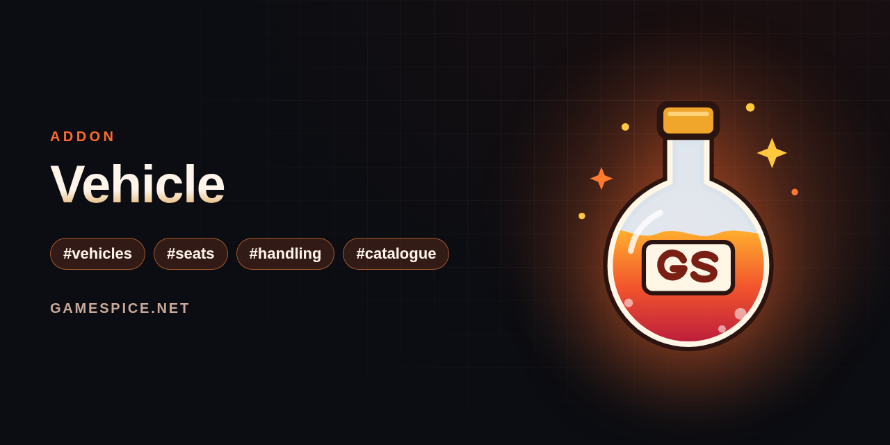

[](https://moddingcommunity.com/a/30-gs-vehicle)

Vehicles for Godot 4: a catalogue of definitions, handling as layered configuration, seats as data, and a safe handover when a player gets in or out. Add it when players should be able to drive somewhere rather than only walk.

## Install

1. Get [Godot 4.7](https://godotengine.org/download).
2. Either use [GameSpice Bootstrap](https://github.com/gamespice-platform/bootstrap), which clones every project and links the addons, or copy `addons/dot_vehicle/` and [GameSpice Core](https://github.com/gamespice-platform/core)'s `addons/dot_core/` into your project and enable dot-vehicle in *Project > Project Settings > Plugins*.

GameSpice Core is the only dependency.

## Use

```gdscript
var vehicles := GSVehicleSpawner.new()
vehicles.authoritative = true                  # on the server only
vehicles.catalogue = catalogue
vehicles.world_ref = GSNodeRef.of_path(^"../World")

# Where the game stops the player's own controller and moves their camera.
vehicles.ride.on_seated = _player_got_in
vehicles.ride.on_unseated = _player_got_out

add_child(vehicles)

var jeep := vehicles.spawn(&"jeep", at, &"alice")
vehicles.ride.enter(jeep, &"alice", alice_node)

# Every simulated tick:
vehicles.set_command(jeep.instance_id, &"alice", command)
vehicles.tick(delta)
```

A definition:

```gdscript
var jeep := GSVehicleDef.make(&"jeep", "res://vehicles/jeep.tscn")

var driver := GSVehicleSeat.make(&"driver", true)
driver.seat_offset = Vector3(-0.4, 0.9, -0.4)

var gunner := GSVehicleSeat.make(&"gunner")
gunner.may_fire = true
gunner.attach_path = ^"Turret"

jeep.seats = [driver, gunner]
jeep.tunables = handling          # a GSConfig: retunable in a file
catalogue.add(jeep)
```

## Getting out safely

A player in a vehicle is a player whose controller must stop simulating, whose camera belongs to the vehicle, and who has to be put back somewhere legal on exit, even if the vehicle is upside down or moving fast. A seat carries candidate exit positions in preference order. `GSVehicleRide` sweeps a body-sized capsule at each, and refuses the exit when none is free.

## Server-authoritative

Rigid-body physics is not identical on two machines, so the server simulates vehicles and clients draw what it sends. A driver's client interpolates the replicated transform instead of predicting it.

## Chassis kinds

| Kind | What it is |
| --- | --- |
| `WHEELED` | Godot's `VehicleBody3D` with the tunables written onto its wheels. |
| `HOVER` | Raycast suspension on a plain `RigidBody3D`: hovercraft, skiff, barge. |
| `CUSTOM` | Your game drives it; GameSpice Vehicle keeps the seats and bookkeeping. |
| Your own | A `GSVehicleChassis` subclass, named by path so a GameSpice Cloud pack can deliver it. |

Godot's `VehicleBody3D` drives along +Z for a positive `engine_force` and turns left for a positive `steering`. `GSVehicleCommand` uses the family's usual conventions and `GSVehicleWheeled` does the translation, so games never have to.

## Driving without a person

`GSVehicleDriver` produces commands from a route, for bots or delivery vehicles.

```gdscript
var driver := GSVehicleDriver.new()
driver.target_speed = 16.0
driver.set_route(PackedVector3Array([checkpoint_a, checkpoint_b, depot]))

jeep.autopilot = driver          # the spawner's tick drives it from here
```

It steers in the vehicle's own frame, brakes for corners, slows towards the last waypoint, and reverses out when stuck. It does not plan routes; they come from GameSpice NPC's graph, a spline or a config file. A person in the driving seat always wins.

## Testing

Import the project once, then run `examples/vehicle_selftest.tscn` headless with Godot. It exits non-zero on failure.

## Status and licence

Part of the [**GameSpice**](https://gamespice.net) platform: a family of Godot addons. Written with Claude Code and maintained by `gamemann`. Every addon has headless tests, but little of this has been played by real users yet, so expect rough edges and please [open an issue](https://github.com/gamespice-platform/vehicle/issues) when you hit one.

MIT licence, see [LICENSE](LICENSE). The only closed part of the [**GameSpice**](https://gamespice.net) platform is the web back end; you can use your own instead of GameSpice's.
